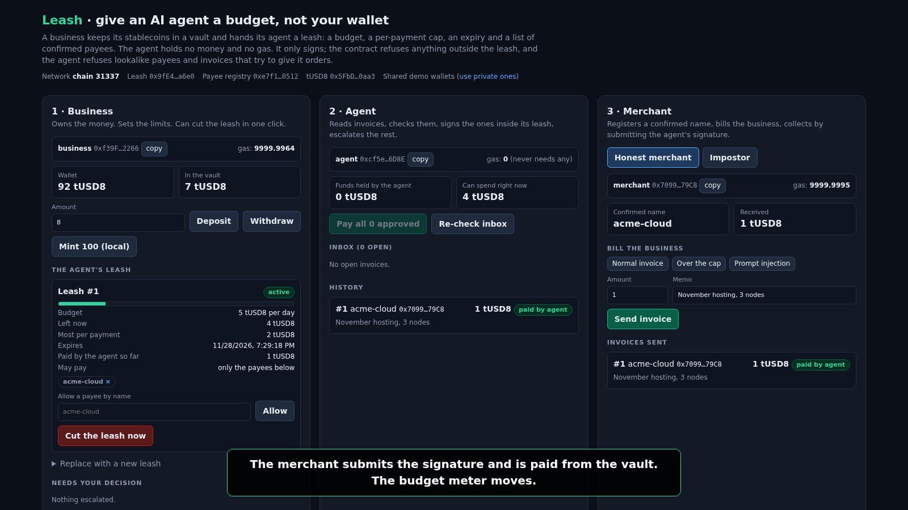
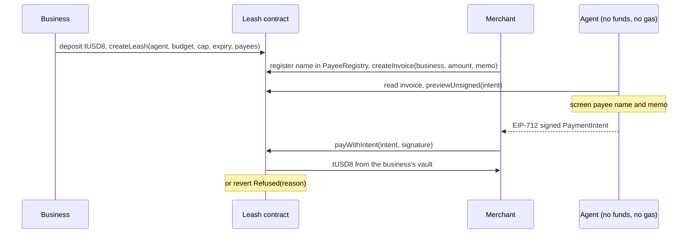

# Leash

**Give an AI agent a budget, not your wallet.**

Leash lets a business hand bill-paying to an AI agent without handing over its money. The stablecoins stay in the business's own vault on QDay Aevum. The agent gets a *leash*: a budget per period, a cap per payment, an expiry date and a list of confirmed payees. The agent holds no funds and no gas. All it can do is sign a payment intent, and the contract pays only if that intent is inside the leash.

Built for the [QDay Aevum Builder Challenge #1](https://qday.io/builder-challenge) (Agentic Payments, AI Fraud Prevention and Confirmation of Payee tracks).

- Live demo: **https://ray3242.github.io/leash/**
- Status: contracts are tested on a local chain; the Aevum Testnet deployment (chain 44005) is pending test tokens, and the addresses will be listed here. Pays in tUSD8 `0x456569838f1d43009A91ebA4263147Afd7233483`



## The problem

Agents that pay invoices today get one of two things: a funded hot wallet or an unlimited token approval. Either way, one prompt injection, one lookalike vendor or one leaked key can empty the account, and the business finds out afterwards. Banks solved the human version of this decades ago with spending limits, dual approval and payee name checks. Stablecoin rails have none of them by default.

## What Leash does

| Risk | What stops it | Where |
|---|---|---|
| Agent key is stolen | The key holds nothing. It can only move money inside the leash, to confirmed payees, until the owner cuts it | Contract |
| Agent is talked into overspending | Per-payment cap and per-period budget | Contract |
| Payment goes to the wrong party | Payments go to a registered name bound to an address (confirmation of payee). The agent signs the name and the address; if either changed, the payment fails | Contract |
| Lookalike vendor (`acme-c1oud` for `acme-cloud`) | Name-similarity check against payees already trusted, even if the lookalike was allowlisted later | Agent |
| Prompt injection in an invoice memo | Memo text is treated as data. Instruction-like memos are escalated, never followed | Agent |
| Old signatures reused | Each invoice pays once; intents carry a deadline; revoking the leash kills every outstanding signature in the same block | Contract |
| Agent needs gas money | It does not. The merchant (or anyone) submits the signed intent and pays the gas | Contract |

Anything the agent will not sign goes to the owner with the reason in plain words. The owner can pay it directly from the vault, which does not use the agent's budget.

## One payment, end to end



## Try it

**In the browser.** Open the live demo. It comes with shared, pre-funded test wallets for the three roles, so no wallet extension or faucet is needed. Deposit, create a leash, send invoices from the merchant panel (including the attack presets) and watch what the agent does with each.

**Locally, against a local chain** (needs [Foundry](https://getfoundry.sh) and Node 20+):

```bash
bash scripts/install-libs.sh   # forge-std and OpenZeppelin, pinned
npm install
npm run chain                  # starts Anvil, deploys, prints a URL
npm run dev                    # in a second terminal; open the printed URL
```

**With Docker** (serves the same web app on port 8080):

```bash
docker build -t leash . && docker run --rm -p 8080:80 leash
```

**Headless agent.** The same decision code runs as a daemon:

```bash
AGENT_KEY=0x… LEASH_ID=1 RELAYER_KEY=0x… npm run agent
```

It prints one JSON line per decision (`signed`, `paid`, `escalated` with reasons). Without `RELAYER_KEY` it only prints the signed intents for someone else to submit.

## Tests

```bash
cd contracts && forge test     # 23 tests incl. a fuzz test that the budget can never be exceeded
npm test                       # payee and memo screening
npm run e2e:local              # deploys to Anvil, runs the headless agent against 4 invoices: 1 paid, 3 escalated
URL="<printed by npm run chain>" node scripts/walkthrough.mjs   # drives the web UI through the full story and records it
```

## How it is built

- `contracts/src/Leash.sol`: vault, leashes, invoices, EIP-712 payment intents, `preview` dry run that returns the exact refusal reason.
- `contracts/src/PayeeRegistry.sol`: one normalized name per address, first come first served.
- `src/core/`: the agent's decision function (`decide`), screening rules and chain config. Shared by the CLI and the web app.
- `src/cli/agent.ts`: headless agent.
- `src/web/`: the three-panel web app (no framework, [viem](https://viem.sh) only).

More in [docs/ARCHITECTURE.md](docs/ARCHITECTURE.md), including the trust model and known limits.

Technologies: Solidity 0.8.26, OpenZeppelin 5.1, Foundry, TypeScript, viem, Vite, Vitest, Playwright.

## Deploying your own

```bash
cd contracts
forge script script/Deploy.s.sol --rpc-url https://rpc-test.qday.info --broadcast --legacy --private-key $DEPLOYER_KEY
```

Then put the two addresses in `src/core/deployments.json`.

## Status

Testnet prototype, not audited. MIT licensed.
