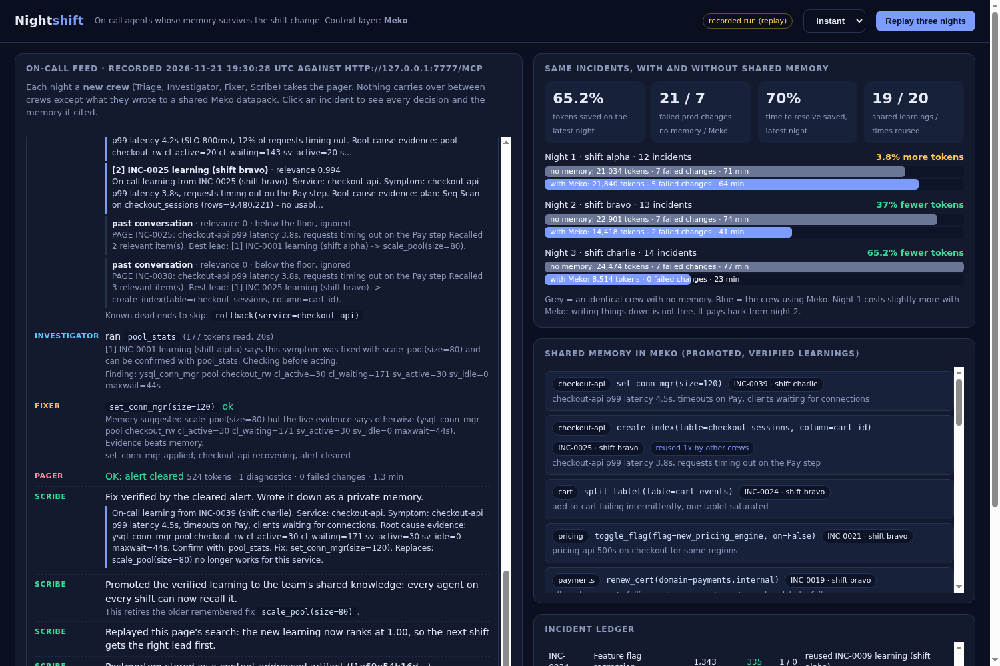

# Nightshift

**On-call agents whose memory survives the shift change. Built on [Meko](https://mekodata.ai) for Yugabyte ContextCon.**

At 3 a.m. the pager goes off and the on-call engineer starts from zero, even though someone on another
shift fixed this exact fault last week. Agent crews have the same problem, only worse: every run is a
new hire. Nightshift is a four-agent on-call crew (Triage, Investigator, Fixer, Scribe) where the
**only** thing that carries over from one night's crew to the next is a shared Meko datapack.

It then measures what that memory is worth by running every incident twice: once with an identical
crew that has no memory, once with the crew on Meko.



## Result

Three nights, three different crews, 39 incidents against a simulated e-commerce stack on a
three-node YugabyteDB cluster. Numbers are from the committed run in `web/replay.json`
(local open-source Meko, deterministic policy, so you will reproduce them exactly).

| Night | Incidents | Tokens (no memory) | Tokens (Meko) | Saved | Failed prod changes (no memory / Meko) | Time to resolve (no memory / Meko) | Fixes reused | New learnings |
|---|---|---|---|---|---|---|---|---|
| Night 1 (alpha) | 12 | 21,034 | 21,840 | -3.8% | 7 / 5 | 71 min / 64 min | 0 | 12 |
| Night 2 (bravo) | 13 | 22,901 | 14,418 | 37.0% | 7 / 2 | 74 min / 41 min | 7 | 6 |
| Night 3 (charlie) | 14 | 24,474 | 8,514 | 65.2% | 7 / 0 | 77 min / 23 min | 13 | 1 |

Across all three nights: 68,409 tokens without memory, 44,772 with Meko (34.6% fewer), 21 failed production changes against 7.

Read it honestly:

- **Night 1 costs more with Meko** (-3.8%). Nothing is known yet and writing things down is not free.
- **Night 2** uses reworded alerts. Meko's semantic search finds 7 of the 12 earlier fixes; the 5
  it misses are solved the slow way and written down again under the new wording.
- **Night 3** reuses 13 of 14 and makes zero failed production changes.

## What Meko does here

Meko is the whole context layer. There is no other store, cache or vector index in this repo.

| Meko capability | How Nightshift uses it |
|---|---|
| Shared datapack | One datapack per on-call rotation. Each shift is a new crew with new agent ids. |
| `context_search` | Triage's first move on every page: one call across shared knowledge, private memories and past conversations. |
| Private memory (`memory_add`) | Scribe writes a learning only after the alert actually cleared. Unresolved incidents leave a private handoff note that is never promoted. |
| Shared knowledge (`memory_promote`) | The verified learning is promoted so every agent on every later shift can recall it. |
| Knowledge base (`knowledgebase_upload_file`, `knowledgebase_search`) | Runbooks. Before a risky change, Fixer asks the knowledge base whether a change policy applies (for example: snapshot before purging WAL). |
| Decision traces (`conversation_add_message` with reasoning, plan, metadata) | Every diagnostic and every production change is recorded with why it was chosen and which memory it cited. Each role keeps its own thread, linked by one `run_id` per incident. |
| Artifacts (`artifact_put`) | A postmortem per incident, content-addressed. |
| Token tracking (`track_token_usage`) | Reported per incident where the deployment exposes it (Meko Cloud). Skipped on local builds that do not. |

Four behaviours that make shared memory safe rather than just fast:

1. **Memory is a lead, not an order.** A recalled fix is confirmed with one live diagnostic first.
   The look-alike incident (same symptom, different cause) recalls the wrong fix at relevance 0.99
   and still gets the right one, with no failed change.
2. **Stale memory gets corrected.** On night 3 the connection pooler has been replaced. The crew
   recalls `scale_pool`, sees live evidence that disagrees, applies `set_conn_mgr`, and writes a
   new learning that retires the old one.
3. **Only verified fixes are shared.** Promotion requires the alert to clear.
4. **Nothing is written twice.** A reused fix adds no new memory, so the datapack stays small.

After each new learning Scribe replays the search that came up short and records the relevance
before and after, so you can see the gap close.

## Run it

Requirements: Python 3.9+ and a Meko endpoint. No other dependencies, no LLM key.

```bash
# 1. Meko, either local and open source (Apache 2.0):
curl -fsSL https://mekodata.ai/install.sh | sh
meko start
#    or Meko Cloud (free plan, no card): create an API key and
export MEKO_API_KEY=...        # uses https://mcp.mekodata.ai/mcp

# 2. Nightshift
git clone https://github.com/ray3242/money-plays && cd money-plays/nightshift
python -m nightshift doctor            # checks the connection
python -m nightshift bench             # three nights, prints the table above (about 30 s)
python -m nightshift serve             # live dashboard on http://127.0.0.1:8787
python -m unittest discover -s tests -t . -v   # offline tests, no Meko needed
```

Each run creates a fresh datapack named `nightshift-<timestamp>`. Open the Meko UI
(`http://127.0.0.1:7777` locally) to browse its memories, traces and artifacts.

`web/` is also a static site: opened without the server it replays the committed run. Hosted at https://ray3242.github.io/nightshift/ (demo video: https://ray3242.github.io/nightshift/demo.mp4).

### With a real model (optional)

```bash
export OPENAI_BASE_URL=...  OPENAI_API_KEY=...  NIGHTSHIFT_MODEL=...
python -m nightshift bench --quick --llm
```

Any OpenAI-compatible endpoint. The model picks each step; the sandbox, Meko calls and scoring are
unchanged. This path is implemented but **was not exercised for the published numbers**: no model
key was available on the free-only budget this was built under.

## How it is built

```
nightshift/
  meko.py      Meko MCP client (JSON-RPC over HTTP, standard library only)
  crew.py      Triage, Investigator, Fixer, Scribe and everything they write to Meko
  brain.py     the decision policy: weigh recalled context against live evidence
  llm.py       optional real-model brain
  sandbox.py   14 fault scenarios with noisy diagnostics, wrong-fix penalties, change guardrails
  bench.py     three nights, memory vs no memory
  server.py    live dashboard backend
runbooks/      what gets indexed into the Meko knowledge base
web/           dashboard and recorded run
```

## Limits

- The production environment is a simulator. Faults, diagnostics output and timings are scripted;
  "time to resolve" is simulated seconds, not wall clock.
- The published numbers use a deterministic rule-based policy, not an LLM, so that anyone can
  reproduce them for free. Token counts are what an LLM would have had to read and write
  (chars/4 estimate; install `tiktoken` for exact counts).
- Measured against local Meko 1.20261116.0. Meko Cloud uses the same MCP tools but was not run here.
- Twelve fault types is a small world. Recall at this size says little about recall at ten thousand learnings.

## License

Apache 2.0.
