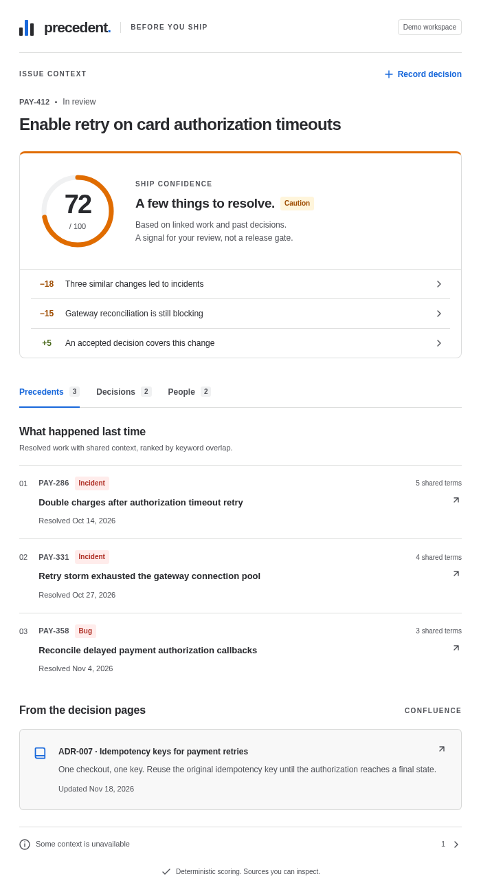
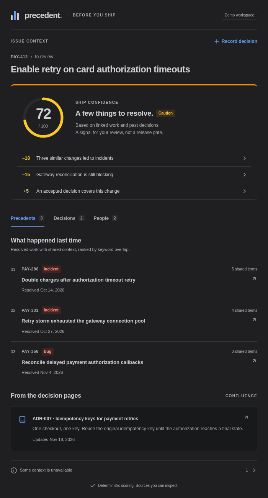
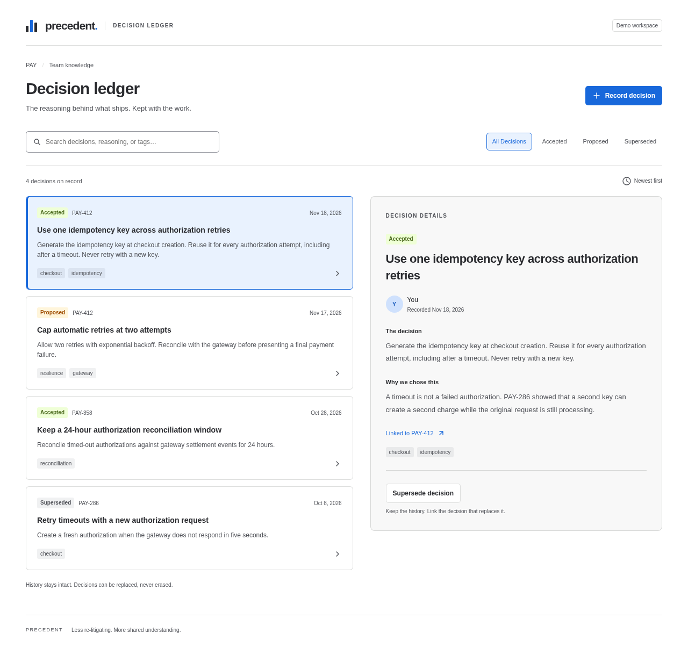
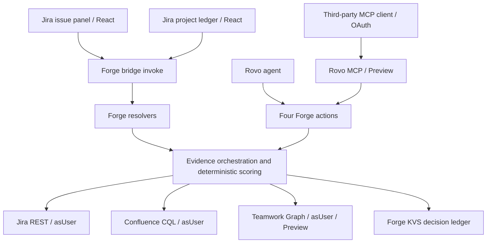

# Precedent

**Before you ship, know what was decided and what happened last time.**

Precedent puts prior Jira incidents, Confluence decisions and the people who worked
on them next to the issue under review. An explainable ship-confidence score helps
start a release conversation. A decision ledger keeps the reasoning for next time.

Built by Rayhan for Codegeist 2026, **Apps for Software Teams**.





## Features

- Jira issue panel: animated score, ranked factors, expandable evidence and source links.
- Resolved precedents ranked by shared keywords; Confluence ADR/decision search.
- People with context from assignees of similar issues.
- Searchable ledger with accepted/proposed/superseded filters, decision details,
  record forms and author-only superseding. Originals stay on record.
- Rovo agent with four reusable actions and the same tools through Rovo MCP (Preview).
- Optional Teamwork Graph assigned-work context, with visible fallback warnings.
- Native light/dark themes, keyboard controls, reduced-motion support and useful
  loading, empty and error states.

## Architecture



`src/lib` holds adapters, permissions, scoring and ledger storage. `src/resolver.js`
serves Custom UI; `src/actions.js` serves Rovo/MCP. Two Vite entrypoints reuse
`static/shared`. Standalone development previews use local fixtures; production
builds remove them. There is no external application server.

## How scoring works

Start at 100, sum the applicable factors, then clamp to 0–100. Ready: **80–100**;
Caution: **55–79**; At risk: **0–54**. This is a heuristic, not a deployment gate,
probability of success, security audit or test-run result.

| Factor | Points | Evidence |
| --- | --- | --- |
| Unresolved blockers | −15 each, cap −30 | Inward “is blocked by” links not done/resolved |
| Unresolved linked bugs | −8 each, cap −24 | Linked Bug work items not done/resolved |
| Reopened after completion | −10 each, cap −20 | Available completed-to-active changelog transitions |
| Short description or missing acceptance criteria | −10 | Under 40 characters, or no supported AC marker |
| Past failures in similar work | −6 each, cap −18 | Returned bug/incident/revert precedents |
| Referenced decision superseded | −5 once | Superseded ledger decision linked to this issue |
| Accepted decision linked | +5 once | Accepted ledger decision linked to this issue |

Keywords come from summary, description, labels and components (top six, with
summary weighting). Jira searches resolved work in the same project and ranks
up to eight results by keyword overlap. Confluence searches decision/ADR titles
or labels. Partial changelogs, missing Graph data and unavailable Confluence
search produce warnings. Graph does **not** change the score.

## Privacy and security

- Product reads use `asUser()`, including Teamwork Graph, not elevated `asApp()`.
  Jira/Confluence permissions still apply. No configured external data egress or
  external LLM API; scoring has no LLM cost. Forge, Atlassian product and Rovo/client
  subscriptions or usage charges can still apply.
- Only decisions are persisted by the app in Forge KVS: title, text, rationale,
  tags, author account ID, timestamps and optional issue/project references.
  No separate database, copied issue archive or credential store.
- Linked decisions are checked against issue access before being returned.
  Unlinked decisions are app-installation-level team knowledge, **not private**;
  do not put secrets in them. Current ledger search scans at most 500 entries.
- Only the original author can supersede a decision. Inputs are validated on
  the server. Rovo instructions require explicit confirmation before recording;
  retrieved content is treated as untrusted data.
- External MCP is off by default, requires admin enablement and OAuth consent,
  and runs under the invoking user's permissions. A third-party agent receives
  tool results when a user explicitly connects it; its own data policies apply.
- The seed script is separate local admin tooling. It uses Basic auth credentials
  from the environment against the specified Atlassian Cloud site, never KVS.
  Do not commit tokens or display them while recording.

## Install and deploy

Prerequisites: Node 22, npm, Forge CLI, an Atlassian account and a site with Jira
and Confluence. Rovo access is needed for the agent; external MCP/Graph are Preview.
See [HANDOFF.md](HANDOFF.md) for the ordered account-only steps and sharing flow.

```sh
git clone https://github.com/ray3242/money-plays
cd money-plays/precedent
npm ci
forge login
forge register # replace the fake app.id with your own registration
npm run build
npm test
npm run validate:manifest
forge deploy --environment development
forge site provision
forge install --demo-site --product Jira --environment development
forge install --demo-site --product Confluence --environment development
```

Approve the requested permissions and complete first-use consent when opening
Precedent. Do not deploy the all-zero placeholder app ID. For judge installation,
deploy **production** and enable **Sharing** in the developer console, not just a
development installation. Run `forge lint` after login; offline schema validation
does not replace an authenticated Forge check or live smoke test.

## Demo data

```sh
node scripts/seed-demo.mjs --dry-run
# Set ATLASSIAN_SITE, ATLASSIAN_EMAIL, ATLASSIAN_API_TOKEN securely in your shell.
# Optional PROJECT_KEY=PAY and SPACE_KEY=PAY (both defaults).
node scripts/seed-demo.mjs
```

Use a disposable development site, not a production team project. The script
creates or reuses a project and space, skips exact existing issue summaries/page
titles, resolves three precedents using Done-category transitions, verifies a
resolution, adds a blocker link, and labels two Confluence pages. It does not
overwrite existing descriptions or force Jira issue numbers. Open the target URL
printed at the end; on a new project it will usually be PAY-5, not PAY-412.
Run sequentially; simultaneous seed runs are not supported. A failure stops the
script; fix permissions/workflow and rerun. No deletes or destructive resets.

Record the accepted idempotency decision through the panel to populate KVS.
Before that, an otherwise clean seed scores 67; after recording it, **72 / Caution**.
The REST seed cannot write app-isolated Forge KVS. The screenshots are standalone
fixtures, including fixed dates and two example people; live dates, keys and
assignees reflect the site and seeding user. Search indexing can take time.

## Development and tests

| Command | Purpose |
| --- | --- |
| `npm run preview:panel` | Standalone fixture panel, localhost:4173 |
| `npm run preview:ledger` | Standalone fixture ledger, localhost:4174 |
| `npm run build` | Build both manifest resource directories |
| `npm test` | Vitest backend, React interaction and seed-plan tests |
| `npm run validate:manifest` | Offline schema and reference/resource checks |
| `node scripts/seed-demo.mjs --dry-run` | Credential-free, network-free seed plan |
| `node scripts/verify-ui.mjs` | Playwright checks/screenshots; both previews must run |

Use `?theme=dark`, `?state=empty`, `?state=error` in previews. Demo changes live in
localStorage under `precedent-demo-decisions`; clear it to reset. Install a browser
with `npx playwright install chromium`, or set `CHROME_PATH` to an existing Chrome.
Generated `dist` directories are ignored: build before validating a fresh checkout.

Live authentication, deployment, Graph availability and judge installation still
need verification on Rayhan's account. [SUBMISSION.md](SUBMISSION.md) contains
paste-ready text; [DEMO_SCRIPT.md](DEMO_SCRIPT.md) covers the recording.
