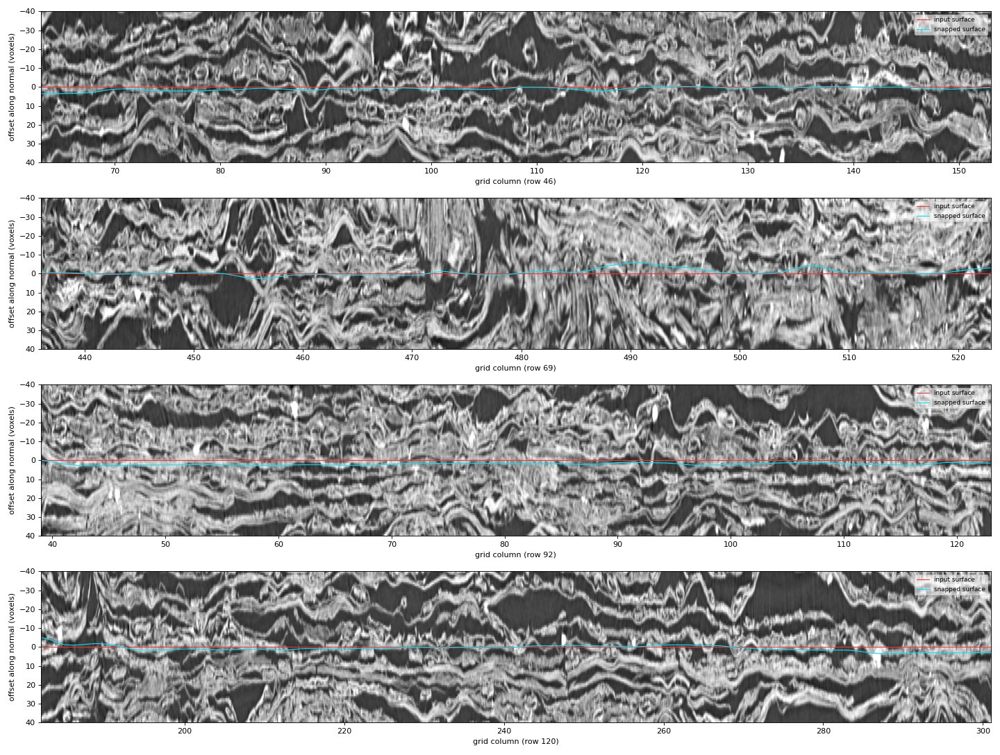
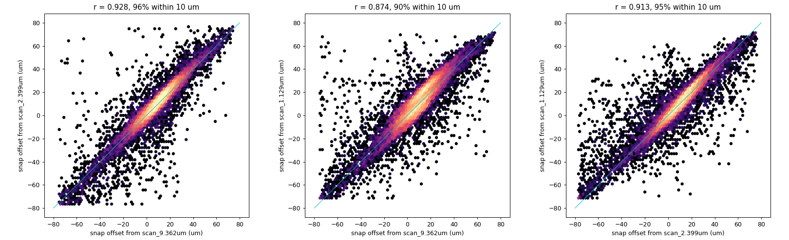
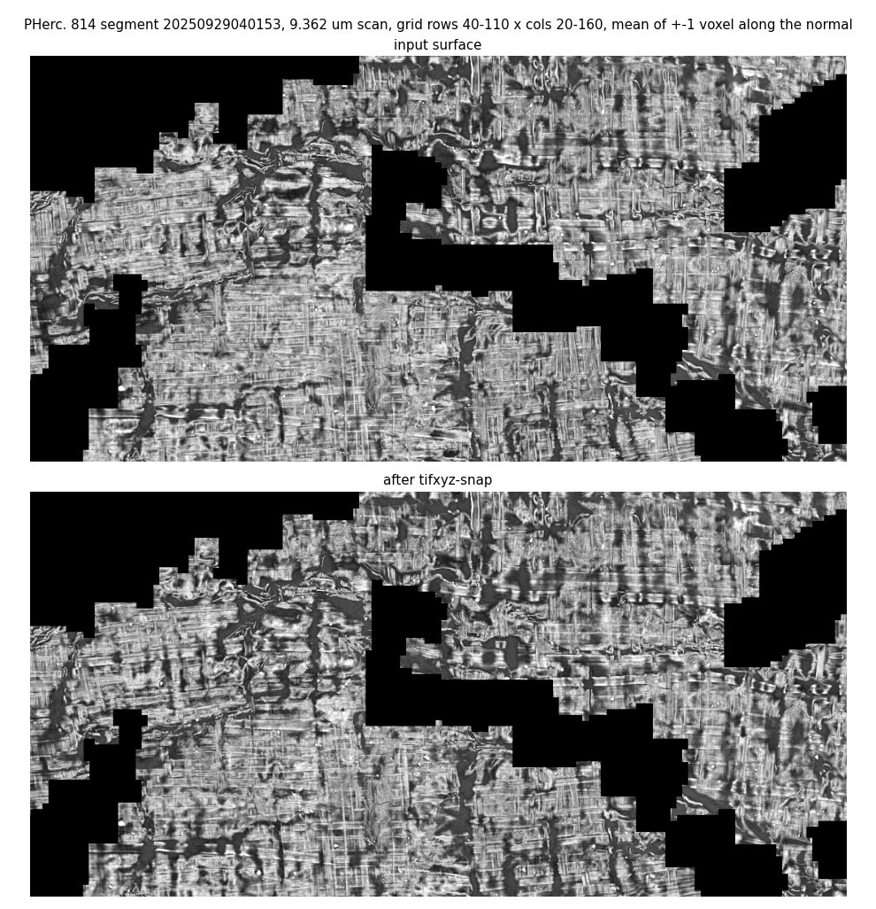

# tifxyz-snap

Snap an approximate `tifxyz` surface back onto the papyrus sheet in the raw CT. CPU only, no model, no training data, streams only the chunks it needs from the public Vesuvius Challenge bucket.

It targets the "label snapping" direction in the [2026 open problems](https://scrollprize.org/open_problems):

> A useful direction is **label snapping**: using the raw CT signal and local geometry to move approximate labels back onto the most plausible papyrus surface / fiber.



*PHerc. 814, segment `20250929040153`, 2.399 um scan at pyramid level 2. Each panel is the CT resampled along the surface normal, so the input surface is the straight red line; cyan is the snapped surface.*

## What it does

Input: a `tifxyz` directory (`x.tif`, `y.tif`, `z.tif`, `meta.json`) and a Zarr v2 / OME-Zarr volume (local path or `https://` URL).
Output: a new `tifxyz` with the same grid, every valid vertex moved along its normal onto the nearest sheet face, plus an offset map, a confidence map, a JSON report and QA figures.

1. Tangent frame and normal per vertex from the (hole-aware, smoothed) grid.
2. CT sampled along each normal, +-8 voxels in 0.5 voxel steps, averaged over a 5x5 tangent-plane patch so single fibres and noise do not dominate.
3. Per-vertex cost for every candidate offset: strength of the air-to-papyrus intensity edge (the face the input surface already sits on is detected automatically; `--target center` follows the sheet mid-line instead).
4. Semi-global matching over the grid: 8-direction dynamic programming with a truncated-linear smoothness term, so neighbours move together but the surface may still step across real discontinuities and holes.
5. Sub-step parabolic refinement, second pass from the moved surface, total move clamped to the search range.

Nothing is learned and nothing is tuned per scroll. Defaults were fixed on the 9.362 um scan and reused unchanged on the other two.

## Install and run

```bash
pip install "git+https://github.com/ray3242/money-plays#subdirectory=vesuvius"

B=https://vesuvius-challenge-open-data.s3.us-east-1.amazonaws.com/PHerc0814
tifxyz-snap snap ./my_segment.tifxyz \
  $B/volumes/20250804134230-9.362um-1.2m-113keV-masked.zarr \
  --cache ~/.cache/tifxyz-snap -o ./my_segment_snapped.tifxyz
```

Useful flags: `--level N` (pyramid level; mesh coordinates are scaled by `1/2**N` automatically), `--search`, `--target {edge,edge+,edge-,center}`, `--smooth-lambda`, `--iterations`. `tifxyz-snap validate` runs the perturbation test below on your own segment, `tifxyz-snap render` writes a flattened texture.

## Results on real data

Everything below is reproduced by [`scripts/reproduce_pherc0814.sh`](scripts/reproduce_pherc0814.sh) (public data, no credentials, about 20 GB of chunk cache; run time is dominated by the download). Raw reports are in [`docs/results`](docs/results).

Segment: `PHerc0814/segments/20250929040153-auto_grown_20250929040153260`, 40.6k vertices, as published registered onto three independent scans.

| scan (level used, voxel) | edge strength before -> after | median move | 95th pct move | vertices moved > 1 voxel | time (8 cores, incl. download for the last two) |
|---|---|---|---|---|---|
| 9.362 um (L0, 9.4 um) | 6.38 -> 7.10 (+11%) | +1.09 vox | 3.73 vox | 60% | 16 s |
| 2.399 um (L2, 9.6 um) | 4.97 -> 5.54 (+11%) | +1.18 vox | 3.97 vox | 62% | 123 s |
| 1.129 um (L3, 9.0 um) | 5.42 -> 6.07 (+12%) | +1.29 vox | 4.21 vox | 65% | 123 s |

Edge strength rising is expected (it is what the cost optimises), so it is not the evidence. The two tests below are.

### 1. Three independent scans give the same correction

The same grid vertices were snapped three times, each time against a different scan (different date, beam energy and resolution, so independent noise). The offset fields agree:



| pair | Pearson r | median difference | within 10 um |
|---|---|---|---|
| 9.362 um vs 2.399 um | 0.928 | 2.9 um | 96% |
| 9.362 um vs 1.129 um | 0.874 | 5.0 um | 90% |
| 2.399 um vs 1.129 um | 0.913 | 2.9 um | 95% |

The corrections themselves are about 18-20 um RMS, so the disagreement between scans is several times smaller than the move being applied. A snapper that followed noise would give uncorrelated fields.

### 2. Perturbation recovery on the real segment

The snapped surface is pushed off the sheet by a smooth random field along the normal and snapped again; the residual is the distance to the first answer.

| perturbation RMS | residual median | within 1 voxel | within 2 voxels | residual RMS |
|---|---|---|---|---|
| 1.45 vox (13.5 um) | 0.21 vox | 91% | 96% | 1.10 vox |
| 2.41 vox (22.5 um) | 0.34 vox | 82% | 91% | 1.92 vox |

So most vertices come back to the same place to a fraction of a voxel, and a tail of roughly 4-9% lock onto a different edge. That tail is the main limitation, see below.

### 3. Fibres stay visible on the snapped surface



Flattened texture of the same grid window (`tifxyz-snap render --upsample 8 --window 40 110 20 160 --half-thickness 1`). Horizontal and vertical papyrus fibres are visible on the snapped surface and the texture does not break up, which it would if vertices had jumped to a neighbouring wrap. The input was already close to the sheet, so the visual change is modest; the quantitative evidence is tests 1 and 2.

## Limitations

- It moves vertices only along the normal, by at most `--search` voxels. It fixes a surface that is slightly off the sheet; it does not fix a surface on the wrong wrap, and in tightly compressed regions a large perturbation can make it jump to the neighbouring sheet (the tail in the table above).
- There is no manually verified ground truth here. The evidence is cross-scan agreement and self-consistency, not error against a hand-checked surface, and I have not measured the effect on downstream ink detection.
- Tested on one segment of one scroll (PHerc. 814) at about 9 um voxels. Finer levels work but download far more data.
- Rendering a whole segment needs about 2 GB of RAM (points are sampled block by block, so memory does not grow with the segment's bounding box).
- Reads Zarr v2 only (the format of the public bucket), codecs supported by `numcodecs`.
- `snap_confidence.tif` is a relative cost margin, not a calibrated probability.

## Tests

```bash
pip install -e ".[dev]" && pytest && ruff check .
```

The 12 tests use a small synthetic sheet with known ground truth (recovery of a biased surface, automatic face detection, holes, empty space, I/O, the CLI end to end). They are regression tests only; the usefulness claims above rest on the real-scroll runs.

## Provenance

Written with heavy use of an AI coding agent (Devin), run and checked on real scroll data before publishing. MIT licensed. Scroll data is from the Vesuvius Challenge open data bucket and is not redistributed here; the figures are derived from it under its data terms.
